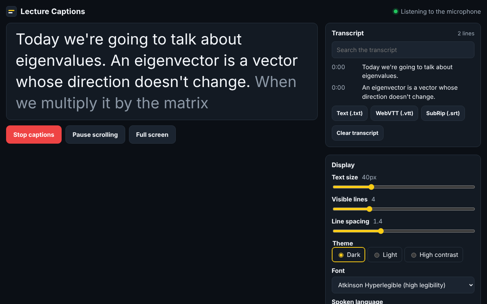

# Lecture Captions

[](https://github.com/PiyushaKadam07/Live-Lecture-Captioning/actions/workflows/deploy.yml)

**Live captions so Deaf and hard of hearing students can follow every lecture.**

**[Try it](https://piyushakadam07.github.io/Live-Lecture-Captioning/)**: open it in any up-to-date browser, press Start and talk. Nothing to install, no account.

Lecture Captions turns a lecturer's speech into large, readable captions in real time. The browser records the microphone, cuts the audio at natural pauses and sends it to a speech server I run on Google Cloud, where OpenAI's Whisper model turns it into text. On 1 hour of recorded TED talks, the live captions have an **8.2% word error rate**, and on Cloud Run an 11-second clip is transcribed in about 2.3 seconds.



## What it does

- **Live captions** from the microphone, in large text that's easy to read from the back of a room.
- **Two speech engines**, chosen in the settings:
  - **Whisper** (default): my own speech server on Google Cloud Run. Works in Chrome, Edge, Firefox and Safari. English only for now.
  - **Browser speech**: the Web Speech API built into Chrome and Edge. Shows words as they're spoken and supports many languages, but only works in those two browsers.
- **Display settings**: font size, line spacing, number of lines, dark and high-contrast themes, and a dyslexia-friendly font. Saved on the device.
- **Transcript**: every caption with a timestamp, searchable, and downloadable as `.txt`, or as `.vtt` / `.srt` subtitles for a lecture recording.

It's meant to support human interpreters and captioners, not replace them. They aren't available for every office hour, study group or recorded video, and that's the gap this fills.

## How it works

```
 Browser (React + TypeScript, GitHub Pages)                Google Cloud Run
 ┌──────────────────────────────────────────────┐        ┌───────────────────────────┐
 │ microphone ─► AudioWorklet ─► Chunker         │  WAV   │ FastAPI  POST /transcribe │
 │                 (audio thread)  cut at pauses ├───────►│ faster-whisper (base.en,  │
 │                               ─► 16 kHz WAV   │        │ int8 on CPU) in Docker    │
 │ captions + transcript ◄─ results, in order ◄──┼────────┤ ◄── text                  │
 └──────────────────────────────────────────────┘  JSON  └───────────────────────────┘
```

1. **Recording.** An [AudioWorklet](public/recorder-worklet.js) collects microphone samples on the browser's audio thread, so a busy page can't cause gaps in the audio.
2. **Cutting at pauses.** The [Chunker](src/recognizers/audio.ts) waits for at least 3 seconds of audio, then cuts at the next 100 ms of quiet, and always cuts by 8 seconds. Cutting on a fixed timer would split words in half. Chunks that are silent all the way through are never sent, which saves money and stops Whisper from inventing words in silence (it's known for writing "Thanks for watching!" on empty audio).
3. **Sending.** Each chunk is downsampled from 44.1/48 kHz to 16 kHz and wrapped as a WAV file. Chunks are sent [one at a time, in order](src/recognizers/whisper.ts), each with the last 200 characters of text as a prompt, so sentences and spellings carry on from one chunk to the next.
4. **Transcribing.** The [server](backend/main.py) is a small FastAPI app running faster-whisper `base.en` with int8 weights, packed in Docker with the model already inside, so a cold start doesn't need a download. The transcription endpoint is a plain `def`, not `async def`, so FastAPI runs Whisper in a worker thread and one slow request doesn't block the others.
5. **If the connection drops**, captions keep listening, show one message (not one per chunk) and carry on when the server is reachable again. When you press Stop, the last unfinished chunk is still sent, so the final sentence isn't lost.

Both engines follow the same [`Recognizer`](src/recognizers/Recognizer.ts) interface, so the captions, transcript and exports don't care which one is running.

## How accurate is it?

I measured word error rate (WER), the share of words that are wrong, missing or added, on 4 talks (1 hour) from the [TED-LIUM](https://huggingface.co/datasets/distil-whisper/tedlium-long-form) test set: real speakers with human-written transcripts. Both texts go through Whisper's English normalizer first, so "It's 25%" and "it is twenty five percent" count as the same words. Speed was measured on a 2-core GitHub Codespace.

| Model | Mode | WER | Speed |
|---|---|---|---|
| tiny.en | whole file | 6.1% | 21.6× real time |
| tiny.en | live chunks | 21.4% | 1.3× real time |
| **base.en** | whole file | **4.7%** | 11.5× real time |
| **base.en** | **live chunks** | **8.2%** | 2.6× real time |

"Whole file" gives Whisper the entire talk at once, which is the best it can do. "Live chunks" cuts the audio exactly the way the app does, so that row is what students actually see.

What the numbers say:

1. **Going live costs accuracy.** With base.en, WER goes from 4.7% to 8.2% when Whisper only hears a few seconds at a time instead of the whole talk.
2. **The small model can't cope with short chunks.** tiny.en is fine on whole files (6.1%) but falls apart on live chunks (21.4%). That's why the server runs base.en.
3. **Live captions are expensive to compute.** Whisper always works on 30-second windows, so a 5-second chunk costs as much as 30 seconds of audio. An hour of lecture is about 120 windows as one file but about 700 as live chunks, which is why the live rows run 4 to 17 times slower.

On Cloud Run (2 vCPU), an 11-second clip takes about 2.3 seconds to transcribe. To reproduce the table:

```bash
cd backend
pip install -r requirements.txt -r requirements-eval.txt
python evaluate_wer.py --models tiny.en base.en --talks 4
```

## Running it yourself

### The web app

```bash
git clone https://github.com/PiyushaKadam07/Live-Lecture-Captioning.git
cd Live-Lecture-Captioning
npm install
npm run dev        # http://localhost:5173
npm test           # 27 tests
```

By default the app uses my Cloud Run server. To point it at your own, set `VITE_SPEECH_SERVER_URL`, for example `VITE_SPEECH_SERVER_URL=http://localhost:8000 npm run dev`.

### The speech server

```bash
cd backend
pip install -r requirements.txt
uvicorn main:app --port 8000          # API docs at http://localhost:8000/docs
```

Or with Docker:

```bash
docker build -t lecture-captions-api backend
docker run --rm -p 8080:8080 lecture-captions-api
```

| Endpoint | What it does |
|---|---|
| `GET /health` | Returns the status and the model name |
| `POST /transcribe` | Takes a 16 kHz mono 16-bit WAV (`audio`) and an optional `prompt`, returns the text and timings |

Settings are environment variables: `WHISPER_MODEL` (default `base.en`) and `ALLOWED_ORIGINS` (the websites allowed to call it).

## Deployment

- **Web app:** GitHub Actions runs the tests, builds and publishes to GitHub Pages on every push to `main` ([workflow](.github/workflows/deploy.yml)).
- **Speech server:** Google Cloud Run, built from the Dockerfile with Cloud Build:

  ```bash
  cd backend
  gcloud run deploy lecture-captions-api --source . --region us-east1 \
    --allow-unauthenticated --cpu 2 --memory 2Gi \
    --min-instances 0 --max-instances 2 --concurrency 4
  ```

  `--min-instances 0` turns the server off when nobody is using it, so it costs nothing when idle. The trade-off is a few extra seconds before the first caption. `--max-instances 2` caps the cost.

## Project structure

```
src/
  recognizers/
    Recognizer.ts     the interface both engines follow
    whisper.ts        Whisper engine: microphone, sending chunks, error handling
    audio.ts          Chunker, downsampling and WAV encoding
    webSpeech.ts      browser speech engine (Web Speech API)
  components/         caption view, transcript panel, settings
  captions/           caption segments and timestamps
  export/             .txt, .vtt and .srt export
  useCaptions.ts      React hook that runs an engine and collects captions
public/
  recorder-worklet.js AudioWorklet that records the microphone
backend/
  main.py             FastAPI + faster-whisper server
  Dockerfile          image for Cloud Run, with the model built in
  evaluate_wer.py     the accuracy benchmark above
tests/                Vitest + React Testing Library
```

## Privacy

- In Whisper mode, audio chunks go to the Cloud Run server, are transcribed and aren't stored. In browser speech mode, the browser sends audio to its own speech service (Google in Chrome, Microsoft in Edge). The app says which one applies before the first session.
- Transcripts and settings are saved only in the browser, and can be deleted at any time.
- No accounts, no tracking. Users are reminded to follow their university's rules on recording lectures.

## Limitations

- Captions arrive in pieces, 3 to 8 seconds behind the speaker, not word by word.
- The Whisper engine is English only, because the server runs the English-only `base.en` model.
- The server runs on CPUs, so a big class all captioning at once would need more instances or a GPU.
- The server is public, so anyone can send it audio. `--max-instances` caps the cost, but a real deployment would need sign-in or rate limits.

## Roadmap

- [x] Live microphone captions, readable display, transcript and export
- [x] Whisper speech server on Google Cloud Run, with a word error rate benchmark
- [ ] Captions for lecture videos and browser tabs
- [ ] Word-by-word captions using streaming Whisper
- [ ] ASL support: fingerspelling, dictionary lookup, and course glossaries with sign videos, built with Deaf users
- [ ] More languages, using the multilingual Whisper models

## License

MIT. See [LICENSE](LICENSE).

Built by **Piyusha Kadam** · [GitHub](https://github.com/PiyushaKadam07)
