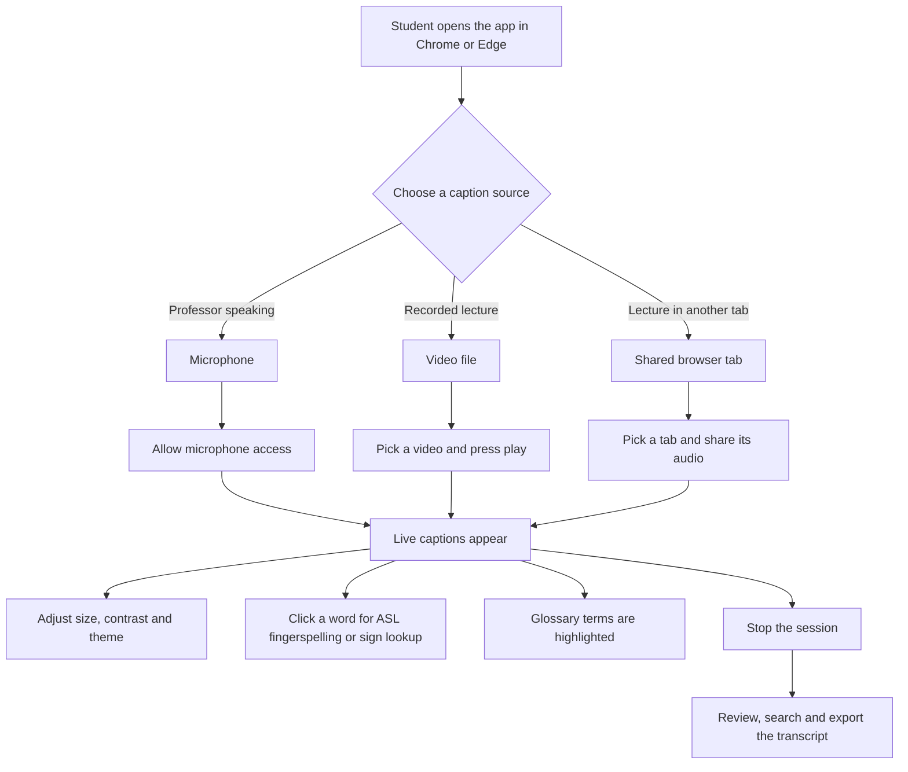
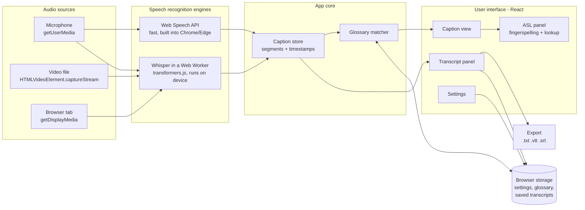

# Lecture Captions

**Live captions and ASL support so Deaf and hard of hearing students can follow every lecture.**

Lecture Captions is a free, browser-based app that turns speech into readable captions in real time, whether a professor is talking in the room or a recorded lecture video is playing. It adds American Sign Language (ASL) support on top of the captions: fingerspelling, one-click sign lookup, and course glossaries where instructors attach real ASL sign videos for technical terms.

It runs entirely in the browser, so any student at any university can use it from a link with nothing to install and no account to create.

> **Status:** in active development. See the [Roadmap](#roadmap) for what is done and what is planned.

---

## Table of contents

- [Why this project](#why-this-project)
- [Features](#features)
- [How it works (user flow)](#how-it-works-user-flow)
- [Architecture](#architecture)
- [Tech stack](#tech-stack)
- [Our approach to ASL](#our-approach-to-asl)
- [Privacy](#privacy)
- [Accessibility](#accessibility)
- [Browser support](#browser-support)
- [Getting started](#getting-started)
- [Project structure](#project-structure)
- [Deployment](#deployment)
- [Roadmap](#roadmap)
- [Contributing](#contributing)
- [License](#license)
- [Acknowledgements](#acknowledgements)

---

## Why this project

Deaf and hard of hearing students often depend on human interpreters or CART captioners. Universities do provide them, but they are expensive, booked in advance, and not available for every office hour, study session, or recorded video. Many lecture recordings have no captions, or auto-generated captions that cannot be adjusted for readability.

Lecture Captions fills those gaps:

- **Always available:** open the app and start captioning in seconds.
- **Works for live and recorded lectures:** the same app handles a professor at the front of the room and a video on a course site.
- **Built for reading:** large text, high contrast, and adjustable size and speed, instead of tiny subtitles.
- **ASL-aware:** connects caption words to ASL resources, which helps students whose first language is ASL.

It is designed to **support**, not replace, qualified interpreters and captioners.

---

## Features

### Live captions from a microphone
Captions what the professor says, live, using the device microphone. Words appear as they are spoken and are corrected as the speech recognizer becomes confident.

### Captions for video lectures
- **Video file:** load a lecture recording (MP4, WebM) and get captions while it plays.
- **Browser tab:** share a tab that is playing a lecture (for example YouTube, Canvas, Zoom in the browser) and caption its audio.

### Readable caption display
- Adjustable font size, line spacing, and number of visible lines
- High-contrast and dark themes, plus a dyslexia-friendly font option
- Auto-scroll with a "pause scrolling" option for re-reading
- Full-screen caption mode for projecting in a classroom

### Transcript and export
- Running transcript with timestamps
- Search inside the transcript
- Export as plain text (`.txt`), WebVTT (`.vtt`), or SubRip (`.srt`) for use as video subtitles or study notes

### ASL support
- **Fingerspelling:** click any word in the captions to see it spelled with ASL handshapes, letter by letter, at adjustable speed.
- **Sign lookup:** one click opens that word in public ASL dictionaries.
- **Course glossary:** instructors or students add key terms (for example "mitochondria", "eigenvalue") with a link to a video of the correct sign. Glossary terms are highlighted automatically when they appear in the captions.

---

## How it works (user flow)



**A typical session:**

1. The student opens the app and picks a source: **Microphone**, **Video file**, or **Browser tab**.
2. The browser asks for permission (microphone or tab sharing). The student allows it.
3. Captions appear in large text. Gray text is still being recognized; white text is final.
4. The student taps an unfamiliar word to see it fingerspelled or look up its sign.
5. When the lecture ends, the student stops the session and downloads the transcript as notes or subtitles.

---

## Architecture

Lecture Captions is a **client-side single-page app**. There is no backend server in the first version: all processing happens in the browser, and the app is deployed as static files. This keeps hosting free, makes it easy for any university to adopt, and keeps lecture audio private.



### Main parts

| Part | Responsibility |
|---|---|
| **Audio sources** | Get an audio stream from the microphone, a playing video, or a shared browser tab. |
| **Recognizer interface** | One common TypeScript interface (`start`, `stop`, `onSegment`) so the rest of the app does not care which engine is used. |
| **Web Speech engine** | Uses the browser's built-in `SpeechRecognition`. Very fast and accurate, but only listens to the microphone. |
| **Whisper engine** | Runs OpenAI's open-source Whisper model inside the browser through transformers.js, in a Web Worker so the page stays smooth. Works with any audio stream, including videos and tabs, and works offline after the first model download. |
| **Caption store** | Holds caption segments (text, start time, end time, final or interim) and is the single source of truth for the caption view, the transcript, and exports. |
| **Glossary matcher** | Finds glossary terms in new caption text and marks them for highlighting. |
| **ASL panel** | Shows fingerspelling for a selected word, dictionary lookup links, and the glossary sign video if one exists. |
| **Browser storage** | Saves settings, glossaries, and transcripts on the device (localStorage and IndexedDB). Nothing is uploaded. |

### Key data type

```ts
type CaptionSegment = {
  id: string;
  text: string;
  startMs: number;   // time since the session started
  endMs: number;
  isFinal: boolean;  // false while the recognizer is still guessing
  source: "mic" | "video" | "tab";
};
```

### Why two speech engines?

The Web Speech API is the quickest way to get high-quality live captions, but browsers only let it listen to the microphone, and in Chrome the audio is processed on Google's servers. Whisper fills both gaps: it can caption any audio stream (videos and tabs), and it runs fully on the student's device. Students can switch engines in Settings.

---

## Tech stack

| Area | Choice | Why |
|---|---|---|
| Language | TypeScript | Type safety and clearer code |
| UI | React | Component-based UI, widely used in industry |
| Build tool | Vite | Fast development server and builds |
| Live speech | Web Speech API | Free, built into Chrome and Edge, no API key |
| On-device speech | Whisper via `@huggingface/transformers` | Private, works for any audio stream |
| Audio capture | `getUserMedia`, `getDisplayMedia`, `captureStream`, Web Audio API | Standard browser APIs |
| Background work | Web Workers | Keeps the UI responsive while Whisper runs |
| Storage | localStorage, IndexedDB | Saves data on the device only |
| Testing | Vitest, React Testing Library, Playwright | Unit, component and end-to-end tests |
| Accessibility testing | axe-core | Automated WCAG checks |
| Hosting | GitHub Pages, Netlify or Vercel | Free static hosting with HTTPS |
| CI | GitHub Actions | Runs tests and deploys on every push |

---

## Our approach to ASL

ASL is a complete language with its own grammar. It is **not** English words replaced one by one with signs. Fully automatic translation from spoken English into natural ASL is still an unsolved research problem, and a poor machine translation can mislead the very students it is meant to help.

So this project takes a deliberate, honest approach:

1. **Captions first.** Accurate English captions are the foundation.
2. **Fingerspelling** for names, acronyms, and new terms, which is how signers handle them too.
3. **Dictionary lookup** that sends students to established ASL resources made by and with Deaf signers.
4. **Course glossaries** with real sign videos chosen by instructors, interpreters, or students, which matters most for technical vocabulary that has no widely known sign.
5. **Future research:** signing avatars and sign-language models, built only together with Deaf users and evaluated by fluent signers.

---

## Privacy

Lecture audio can include students' voices and is covered by education privacy rules such as FERPA in the US. The app is designed to minimize what leaves the device.

- **No backend, no accounts, no tracking.** The app is static files.
- **Whisper mode:** audio never leaves the device.
- **Web Speech mode:** in Chrome, audio is sent to Google's speech service to be recognized. The app tells the user this before the first session and lets them switch to Whisper mode.
- **Transcripts and glossaries** are stored only in the browser, and the user can delete them at any time.
- **Recording consent:** users are reminded to follow their university's rules about recording lectures.

---

## Accessibility

The app is built to meet **WCAG 2.1 Level AA**:

- Fully usable with a keyboard, with visible focus indicators
- Screen reader friendly labels and ARIA live regions for status messages
- Color contrast of at least 4.5:1, plus a high-contrast theme
- Respects the system's reduced-motion and dark-mode settings
- Visual alerts only, never sound-only feedback

---

## Browser support

| Feature | Chrome | Edge | Safari | Firefox |
|---|---|---|---|---|
| Microphone captions (Web Speech) | Yes | Yes | Partial | No |
| Microphone captions (Whisper) | Yes | Yes | Yes | Yes |
| Video file captions | Yes | Yes | Yes | Yes |
| Browser tab captions | Yes | Yes | No | No |

Chrome or Edge on a laptop or desktop is recommended. Whisper runs fastest on devices with WebGPU support.

---

## Getting started

### Prerequisites

- [Node.js](https://nodejs.org/) LTS version
- [Git](https://git-scm.com/)
- Google Chrome or Microsoft Edge
- A microphone

No API keys or paid accounts are needed.

### Install and run

```bash
git clone https://github.com/YOUR-USERNAME/lecture-captions.git
cd lecture-captions
npm install
npm run dev
```

Open the address shown in the terminal (usually `http://localhost:5173`) in Chrome or Edge, and allow microphone access when asked.

### Available scripts

| Command | What it does |
|---|---|
| `npm run dev` | Starts the development server with live reload |
| `npm run build` | Creates an optimized production build in `dist/` |
| `npm run preview` | Serves the production build locally |
| `npm test` | Runs unit and component tests |
| `npm run test:e2e` | Runs end-to-end tests in a real browser |
| `npm run lint` | Checks code style |

---

## Project structure

```
lecture-captions/
├── public/
│   └── asl/                     # Fingerspelling handshape images (A-Z)
├── src/
│   ├── audio/                   # Microphone, video and tab audio sources
│   ├── recognizers/
│   │   ├── Recognizer.ts        # Common interface for all engines
│   │   ├── webSpeech.ts         # Web Speech API engine
│   │   └── whisper/             # Whisper engine and its Web Worker
│   ├── captions/                # Caption store and segment logic
│   ├── asl/                     # Fingerspelling, dictionary links, glossary
│   ├── export/                  # .txt, .vtt and .srt exporters
│   ├── components/              # React components (CaptionView, Transcript, Settings...)
│   ├── hooks/                   # Reusable React hooks
│   ├── storage/                 # localStorage and IndexedDB helpers
│   ├── App.tsx
│   └── main.tsx
├── tests/                       # End-to-end tests
├── index.html
├── package.json
└── README.md
```

---

## Deployment

The app builds to static files, so it can be hosted for free anywhere that serves HTTPS (browsers only allow microphone access on HTTPS or `localhost`).

**GitHub Pages with GitHub Actions:**

1. Set `base: "/lecture-captions/"` in `vite.config.ts`.
2. Add a workflow in `.github/workflows/deploy.yml` that runs `npm ci`, `npm run build`, and deploys the `dist/` folder.
3. In the repository, go to **Settings > Pages** and choose **GitHub Actions** as the source.
4. Every push to `main` publishes the app at `https://YOUR-USERNAME.github.io/lecture-captions/`.

**Netlify or Vercel:** import the GitHub repository, set the build command to `npm run build` and the output folder to `dist`.

**For universities:** because there is no backend, an IT department can host its own copy on any web server or learning management system that serves static files.

---

## Roadmap

- [ ] Project setup (Vite, React, TypeScript)
- [ ] Live microphone captions with the Web Speech API
- [ ] Readable caption display (font size, contrast, themes, full screen)
- [ ] Transcript with timestamps, search, and export (.txt, .vtt, .srt)
- [ ] Captions for video files and browser tabs using Whisper
- [ ] ASL fingerspelling and dictionary lookup
- [ ] Course glossary with sign videos and automatic highlighting
- [ ] Accessibility audit (WCAG 2.1 AA) and automated tests
- [ ] Deployment with GitHub Actions
- [ ] Shareable glossaries (import/export as JSON)
- [ ] Multi-language captions and translation
- [ ] Optional instructor "broadcast" mode so students see captions on their own devices
- [ ] Research: signing avatar, built with Deaf community input

---

## Contributing

Contributions are welcome, especially from Deaf and hard of hearing users, ASL interpreters, and accessibility specialists.

1. Fork the repository and create a branch: `git checkout -b feature/your-feature`
2. Make your changes and add tests.
3. Run `npm test` and `npm run lint`.
4. Open a pull request describing what you changed and why.

Please open an issue first for large changes.

---

## License

This project is licensed under the MIT License. See [LICENSE](LICENSE) for details.

---

## Acknowledgements

- The Deaf community, whose guidance of "nothing about us without us" shapes this project
- [OpenAI Whisper](https://github.com/openai/whisper) and [Hugging Face Transformers.js](https://github.com/huggingface/transformers.js) for on-device speech recognition
- Public ASL dictionaries and educators who make sign language resources freely available

---

Built by **Piyusha** · [GitHub](https://github.com/PiyushaKadam07)
